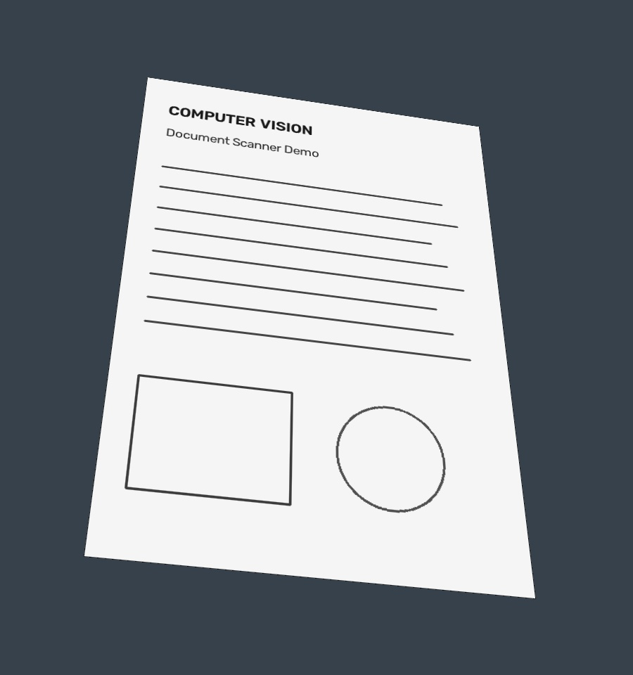
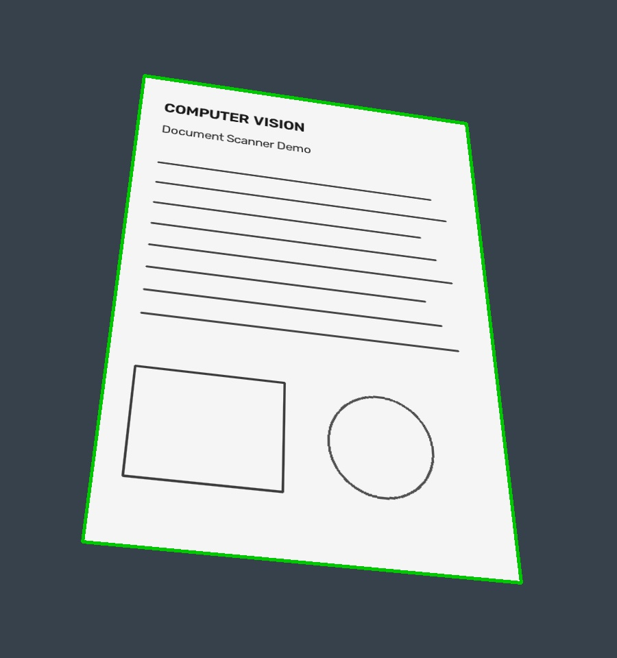
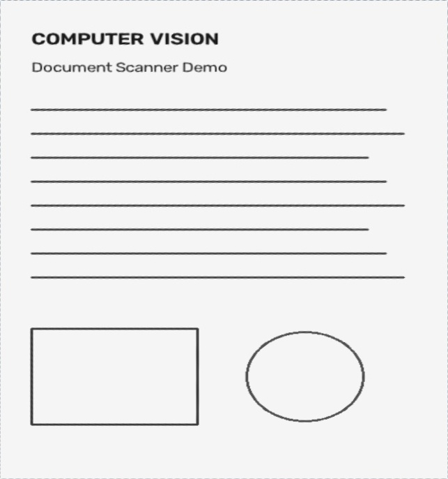
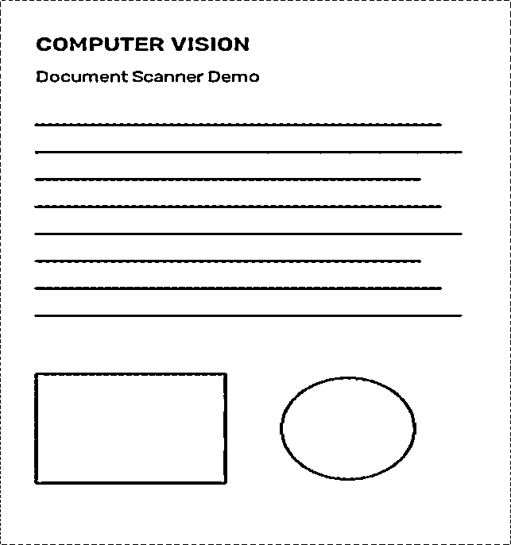

# 本科计算机视觉项目：文档扫描器

用 Python、OpenCV 和 NumPy 将拍摄的纸质文档转换为正视扫描图。无需 GPU、模型训练或外部数据集，适合本科计算机视觉课程设计、实验演示与算法讲解。

## 效果展示

示例是本项目程序生成的合成图，不是实拍效果或真实数据集实验。

| 输入图像 | 自动检测纸张 |
| --- | --- |
|  |  |

| 透视校正 | 黑白扫描 |
| --- | --- |
|  |  |

## 快速开始

建议 Python 3.10–3.12。在项目目录执行：

```bash
python -m venv .venv
```

Windows PowerShell 激活：` .\.venv\Scripts\Activate.ps1`；macOS / Linux 激活：`source .venv/bin/activate`。

```bash
python -m pip install -r requirements.txt
python scanner.py examples/document.jpg
```

结果保存在 `outputs/`：`detected.jpg`（边框）、`edges.png`（缩小后的边缘图）、`rectified.jpg`（彩色校正图）、`scan.png`（黑白图）、`metadata.json`（原图坐标与输出尺寸）。重复运行到同一目录会覆盖同名结果，建议不同图片指定不同输出目录。

处理自己的照片，支持中文路径：

```bash
python scanner.py "我的文档.jpg" --output outputs/my-document
```

自动检测失败时手动输入四角坐标，坐标原点在原图左上角，x 向右、y 向下；输入任意顺序的四个凸四边形顶点：

```bash
python scanner.py examples/document.jpg --corners 210 110 680 180 760 850 120 790 --output outputs/manual
```

重新生成示例和运行测试：

```bash
python make_demo.py
python -m unittest -v
```

## 算法流程

1. 将检测用图像最长边缩至不超过 1000 像素，降低轮廓计算成本，保留原图用于最终校正。
2. 灰度转换和 5×5 高斯滤波，降低噪声。
3. Canny 边缘检测，阈值为 50 / 150；5×5 闭运算连接边缘间隙。
4. 按面积从大到小检查轮廓，以周长的 2% 为近似精度寻找凸四边形；面积须占检测图像至少 15%。
5. 根据角度排序四个顶点，并映射回原图坐标。
6. 利用四对对应点求 3×3 单应性矩阵，完成透视变换。
7. 使用高斯自适应阈值（窗口 21，常数 10）生成黑白扫描图。

平面透视变换可表示为 `s[x', y', 1]^T = H[x, y, 1]^T`。H 有 8 个独立自由度，四对不共线点提供求解所需约束。它能校正平面纸张的透视，不能恢复弯曲书页。

## 文件结构

```text
scanner.py          检测、透视校正、增强及命令行入口
make_demo.py        原创合成图片和真实四角坐标生成
test_scanner.py     算法回归测试
examples/           输入图、真实坐标与处理结果
docs/REPORT.md      实验记录、局限与答辩提示
requirements.txt    运行依赖
```

## 测试与局限

已在 Python 3.12.10、OpenCV 5.0.0、NumPy 2.5.3 环境运行，4 项自动测试通过。测试覆盖合成图检测误差、24 种角点排列、空白图像和退化角点。依赖版本范围内的其他组合尚未逐一验证。

本项目采用传统视觉算法，没有训练集或测试集划分。合成演示不能证明实际场景准确率。复杂背景中的大四边形、纸张低对比度、遮挡、反光、折痕和严重阴影可能导致失败。建议使用深色背景，完整拍入单张纸；用多组实拍图补充实验后再报告准确率。

## 可扩展方向

- 加入图形界面和四角拖动修正。
- 比较不同 Canny 阈值、滤波方式与轮廓近似参数。
- 记录实拍数据的角点误差、检测成功率和处理耗时。
- 加入 OCR，注意扫描增强与文字识别是不同模块。

本项目作为学习与课程设计起点；提交课程作业前请理解算法，并遵循所在课程对辅助工具的规定。
